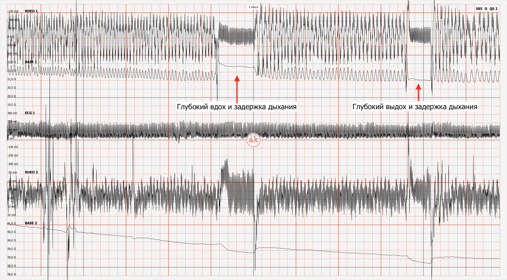

# Coursework
Курсовая работа "Методы Анализа Биосигналов", 2 год магистратуры БМТ-2

## [Исходные данные.csv](2024-10-10%2015-58-01%20018%20rcms.csv)

## Задания по подгруппам

1. Анализ изменения частоты дыхания
2. Анализ изменения глубины дыхания
3. Оценка вариабельности сердечного ритма
4. Определение ударного выброса
5. Удаление паттерна дыхания из пульсового импеданса

## Ход работы

1. Разбиться на подгруппы по **3**
2. В каждой подгруппе кто-то один ответвится от этого репозитория
3. На любом языке программирования реализовать выбранное задание, рассмотрев различные варианты выполнения
4. **Каждый студент** в подгруппе должен сделать хотя бы 1 коммит через Pull Request в свой репозиторий
5. Разрешается пользоваться любыми технологиями ИИ, включая Vibe Coding и Spec Driven Development
6. На каждую подгруппу отчет по ГОСТ 7.32-2017